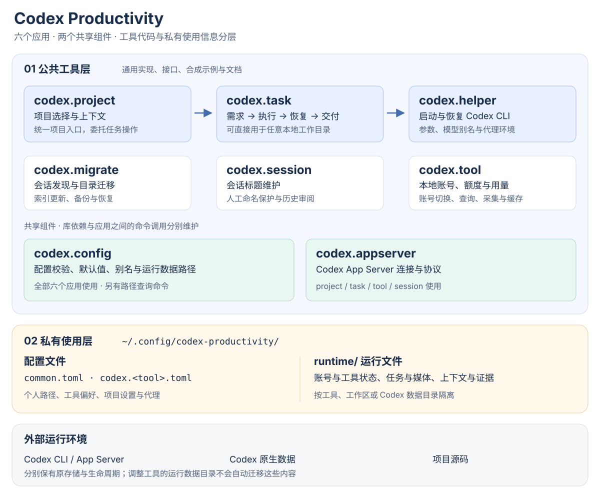
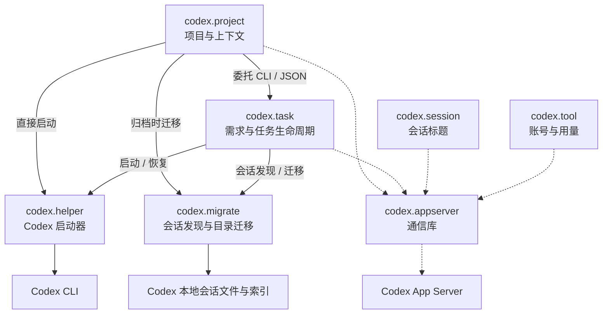

# Codex Productivity 体系架构

Codex Productivity 将围绕 Codex CLI 的日常操作拆成可组合的工具：项目管理负责找到工作目录，任务管理负责需求与交付过程，启动器连接到 Codex；会话迁移、标题维护和账号用量管理分别提供独立能力。共享组件统一配置和 App Server 通信。

本文描述工具职责、实际调用关系和数据归属。具体参数与协议以各仓库的 README、命令帮助和源码为准。这里的“公共工具层”表示不包含个人或业务使用信息的通用实现；源码仓库的访问权限是单独的发布设置。

[返回组织首页](https://github.com/codex-productivity) · [开始使用](getting-started.md)

## 分层总览



| 层次 | 内容 | 设计目的 |
| --- | --- | --- |
| 应用工具 | project、task、helper、migrate、session、tool | 每个工具有明确职责，可从需要的能力开始组合 |
| 共享组件 | config、appserver | 复用配置约定和通信实现，减少工具间重复逻辑 |
| 私有使用信息 | 配置、账号状态、任务账本、媒体、私有上下文、操作证据 | 让真实使用数据独立于通用源码和分发包 |
| 外部运行环境 | Codex CLI、Codex App Server、Codex 原生数据、项目源码 | 由对应系统或项目维护，工具通过明确接口访问 |

前两行共同组成工具层。私有使用层通过配置连接到工具，不需要把个人路径、项目清单或业务内容写进工具源码。

## 应用之间怎样协作

下图中的实线表示命令调用；虚线表示通信库调用。CLI 是命令行接口，JSON 是程序间交换结构化结果的格式。



配置读取关系另见下一节。图中展示主要调用边界；`codex.tool` 的部分账号与用量操作还会访问对应的远端服务。

### 项目、任务与启动器

`codex.project` 管理“项目根目录 / 分组 / 项目”结构和项目上下文。它通过 `codex.task` 的公开命令与 JSON 协议提供任务入口，并传入选定目录；任务账本和任务业务规则由 task 维护。

`codex.task` 能用于任意本地目录，不要求目录先被 project 管理。它负责澄清、发布、执行、恢复、交付记录和清理。Git 任务可以使用独立 worktree，即共享仓库历史、拥有单独工作目录的 Git 工作区；非 Git 目录按相应流程在原目录执行。多仓任务逐仓记录准备、交付和恢复信息。

`codex.helper` 负责启动 Codex CLI，组合模型、参数和代理环境，提供目录与会话补全。它不维护任务账本。任务可以通过 helper 启动，用户也可以直接使用 helper。

### 三项独立能力

| 工具 | 拥有的职责 | 与其他能力的边界 |
| --- | --- | --- |
| `codex.migrate` | 发现本地会话；迁移会话工作目录、关联副本与索引；提供备份和恢复 | 供 project 与 task 调用，也可独立使用；不制定标题命名规则 |
| `codex.session` | 维护当前会话标题，保护人工命名，支持历史标题导出、审阅与应用 | 通过 App Server 读写标题；名称由当前 Agent 或用户提供，不另起模型调用，不直接改写原生数据库 |
| `codex.tool` | 本地账号身份与切换、恢复、额度和用量管理 | 与项目、任务管理独立；凭据、采集结果和缓存属于私有使用层 |

这些工具可并行服务于同一工作流，不要求按固定顺序逐一调用。

## 共享组件与安装依赖

| 应用 | 依赖 `codex.config` | 依赖 `codex.appserver` | 主要调用的同系列命令 |
| --- | :---: | :---: | --- |
| project | 是 | 是 | task、helper、migrate |
| task | 是 | 是 | helper、migrate |
| helper | 是 | — | — |
| migrate | 是 | — | — |
| session | 是 | 是 | — |
| tool | 是 | 是 | — |

`codex.config` 与 `codex.appserver` 不互相依赖。这里的依赖指 Python 包依赖；“调用同系列命令”需要对应可执行文件可用，安装一个应用不会自动安装整套工具。

### codex.config：统一配置和路径

config 负责配置文件解析、字段校验、默认值、代理环境、Shell 别名以及运行数据路径。它同时提供 `codex.config paths` 命令，帮助用户和其他工具查询当前配置实际指向的位置。配置读取和路径查询本身不会创建运行数据。

### codex.appserver：统一通信

Codex App Server 是 Codex 暴露会话等能力的进程接口。appserver 库提供两类连接：本地 Unix socket 上的 WebSocket，以及子进程标准输入输出（stdio）上的 JSON-RPC 请求与响应。它处理传输、版本、身份与错误；调用方决定业务策略和是否允许启动服务。

helper 与 migrate 不导入这个库。helper 可经 Codex CLI 使用相应原生服务；session 不负责启动或重启共享服务。共享库存在于各应用的独立安装环境中，并不意味着所有应用共用一个 Python 进程或同一份运行状态。

## 配置与数据边界

默认配置目录为 `~/.config/codex-productivity/`；设置 `XDG_CONFIG_HOME` 后，默认目录随之变为 `$XDG_CONFIG_HOME/codex-productivity/`。工具支持的显式配置目录与数据路径覆盖，以各自配置说明为准。

```text
<配置目录>/
├── common.toml
├── codex.<tool>.toml
└── runtime/
    ├── codex.tool/                # 账号、额度、用量与采集状态
    ├── codex.session/             # 按 Codex 数据目录隔离的标题状态
    ├── codex.migrate/<home-id>/
    │   └── backups/               # 会话迁移备份
    └── workspaces/<workspace-id>/
        ├── codex.task/            # 任务账本、媒体、工作区与归档
        ├── context/               # 私有规则、知识与当前状态
        └── evidence/              # 本机操作与验证证据
```

`<workspace-id>` 根据工作目录实际路径生成，用来隔离同名项目；`<home-id>` 用来隔离不同 Codex 数据目录。示意名称不是可直接复制的实际标识。

### 工具层可以包含什么

通用代码、公开接口、合成测试数据、配置字段说明、虚构示例和可复用设计。工具文档描述行为与约定，不保存当前使用者的账号、任务进度、安装回执或业务资料。

### 私有使用层承载什么

个人路径、项目清单、工具偏好与代理设置由配置承载；账号状态、会话相关状态、真实任务内容、媒体、业务上下文与验证记录由对应运行文件承载。运行数据目录应保持私有，排除在源码提交、构建包、Release 和配置文本备份之外；需要恢复能力时使用独立的私有备份策略。

`common.toml` 中可用以下配置指定运行数据根目录：

```toml
schema_version = 1

[runtime]
directory = "runtime"
```

相对路径以配置目录为基准。只读定位命令：

```bash
codex.config paths --workspace . --json
codex.config paths --tool codex.tool --json
```

### 迁移与外部数据

修改默认路径不等于已迁移存量数据。已有本地任务账本和显式路径覆盖需要按迁移流程处理：协调写入者、取得锁、确认恢复能力、更新登记路径和 Git worktree 关联，并回读任务状态、媒体与归档。发现多份冲突存储时应先解决归属，避免新旧数据分叉。

Codex 自身的数据目录（通常为 `~/.codex`，也可由 `CODEX_HOME` 指定）、认证入口、共享服务和项目源码是外部输入。修改本系列的运行数据根目录不会自动搬迁它们。

## 从需求到交付的数据流

1. **定位工作目录。** 用户直接指定目录，或由 project 选出项目，再交给 task。
2. **形成任务。** task 保存需求、任务状态、资源归属和后续恢复入口到该工作区的私有任务存储。
3. **执行或恢复。** task 通过 helper 调用 Codex；需要查找或调整会话目录时使用 migrate。
4. **登记交付。** task 按任务协议记录候选、集成和逐仓结果。推送、安装等动作依任务授权执行，工具运行本身不扩大授权范围。
5. **验收与清理。** 要求用户确认的任务保留验收状态；清理遵循锁、会话和资源归属检查，交付记录继续可追溯。

配置与运行数据的集中管理支持这个流程，但不替代各工具已有的事务、锁、身份校验和恢复协议。

## 文档与实现的对应关系

| 要查的细节 | 入口 |
| --- | --- |
| 项目目录、Shell 集成、上下文管理 | [project README](https://github.com/codex-productivity/codex.project#readme) |
| 任务命令、类型、授权和恢复 | [task CLI 协议](https://github.com/codex-productivity/codex.task/blob/main/docs/cli-v1.md) |
| 多仓任务与清理 | [task 多仓说明](https://github.com/codex-productivity/codex.task/blob/main/docs/multi-repository.md) |
| 启动参数和模型别名 | [helper README](https://github.com/codex-productivity/codex.helper#readme) |
| 会话发现与迁移 | [migrate README](https://github.com/codex-productivity/codex.migrate#readme) |
| 会话标题维护 | [session README](https://github.com/codex-productivity/codex.session#readme) |
| 账号、额度和用量 | [tool README](https://github.com/codex-productivity/codex.tool#readme) |
| 配置与路径 | [config README](https://github.com/codex-productivity/codex.config#readme) |
| App Server 通信 | [appserver README](https://github.com/codex-productivity/codex.appserver#readme) |

上述实现仓库目前为私有，需要相应读取权限。本页和组织首页仅包含通用架构与合成示例。
