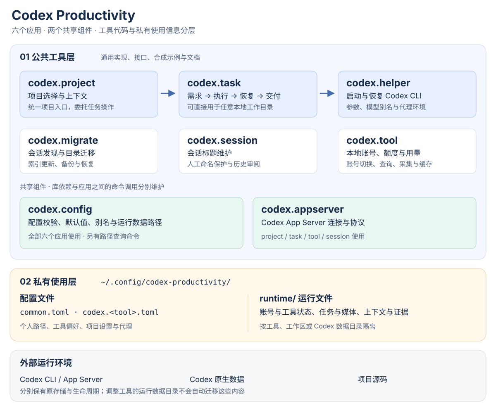

# Codex Productivity

围绕 Codex CLI 的本地开发工具体系：从进入项目、整理需求，到执行任务、恢复会话和交付结果，把重复的操作变成可复用的工作流。

体系由 **六个应用工具、两个共享组件**组成。各工具可以按需组合；公共工具代码与个人配置、账号、任务和会话信息分开保存。

[体系架构](https://github.com/codex-productivity/.github/blob/main/docs/architecture.md) · [开始使用](https://github.com/codex-productivity/.github/blob/main/docs/getting-started.md) · [配置与数据边界](https://github.com/codex-productivity/.github/blob/main/docs/architecture.md#配置与数据边界)



图中箭头表示主要任务工作流。完整的命令调用关系、库依赖和存储边界见[架构文档](https://github.com/codex-productivity/.github/blob/main/docs/architecture.md)。

## 按要做的事情选择工具

| 想完成的事情 | 工具 | 负责什么 |
| --- | --- | --- |
| 在多个项目之间切换，并维护项目上下文 | [codex.project](https://github.com/codex-productivity/codex.project) | 项目发现、创建、进入、上下文检查与归档；提供任务入口 |
| 将需求变成可执行、可恢复的任务 | [codex.task](https://github.com/codex-productivity/codex.task) | 需求澄清、任务发布、执行、恢复、交付记录和工作区清理；支持任意本地目录 |
| 按常用设置启动或恢复 Codex | [codex.helper](https://github.com/codex-productivity/codex.helper) | 启动参数、模型别名、代理环境、目录与会话补全 |
| 项目或任务目录变化后继续使用原会话 | [codex.migrate](https://github.com/codex-productivity/codex.migrate) | 会话发现、工作目录迁移、关联索引更新与备份恢复 |
| 维护清楚、稳定的会话标题 | [codex.session](https://github.com/codex-productivity/codex.session) | 当前会话标题维护、人工命名保护、历史标题审阅与应用 |
| 管理本地账号和查看额度、用量 | [codex.tool](https://github.com/codex-productivity/codex.tool) | 账号身份、切换与恢复、额度和用量查询、采集与缓存 |

两个共享组件让应用遵循一致的基础约定：

| 组件 | 职责 | 使用者 |
| --- | --- | --- |
| [codex.config](https://github.com/codex-productivity/codex.config) | 配置读取与校验、默认值、代理和 Shell 别名、私有运行数据路径；也提供路径查询命令 | 上述六个应用 |
| [codex.appserver](https://github.com/codex-productivity/codex.appserver) | Codex App Server 通信库，封装连接、协议、版本及身份检查 | project、task、tool、session |

## 一条典型工作流

1. **进入项目。** 用 `codex.project` 选择目录、检查项目上下文；已有目录也可直接使用 `codex.task`。
2. **整理和执行需求。** 用 `codex.task` 澄清、发布或立即执行；工具通过 `codex.helper` 启动或恢复 Codex。
3. **继续与交付。** 从原任务恢复，保留任务状态和交付记录；Git 项目可用独立工作区，多仓任务按仓库登记结果。
4. **按需维护。** 用 `codex.session` 管理标题、`codex.tool` 查看账号与用量；目录调整时由 `codex.migrate` 处理会话关联。

任务交付、用户验收和资源清理是独立环节。具体授权、锁和清理条件由任务协议约束。

## 从哪里开始

- **只需要便捷启动：** 从 `codex.helper` 开始。
- **希望把需求按任务管理：** 使用 `codex.task`，配合 helper 与 migrate。
- **需要统一管理多个项目：** 在任务工具之上加入 `codex.project`。
- **需要账号、用量或标题管理：** 按需加入 `codex.tool`、`codex.session`，无需先采用项目管理方式。

完整安装条件、组合顺序和命令示例见[开始使用](https://github.com/codex-productivity/.github/blob/main/docs/getting-started.md)。本首页与架构文档公开可读；目前八个工具源码仓库为私有，访问和安装需要相应仓库权限。

## 公共工具与私有使用信息

工具层保存通用实现、接口、合成示例和设计文档。当前使用的信息通过配置与运行文件承载，默认集中在 `~/.config/codex-productivity/`，并遵循 `XDG_CONFIG_HOME`。

```text
codex-productivity/
├── common.toml            # 通用配置
├── codex.<tool>.toml      # 各工具配置
└── runtime/              # 私有使用信息
    ├── codex.<tool>/      # 工具状态、账号或用量等数据
    └── workspaces/<id>/   # 工作区任务、私有上下文和本机证据
```

真实账号、凭据、会话、任务内容和业务资料不属于公共工具文档或发布包。Codex 自身的数据目录与项目源码仍有各自的存储边界；调整运行数据路径时，需要单独完成存量迁移和校验。详见[配置与数据边界](https://github.com/codex-productivity/.github/blob/main/docs/architecture.md#配置与数据边界)。
